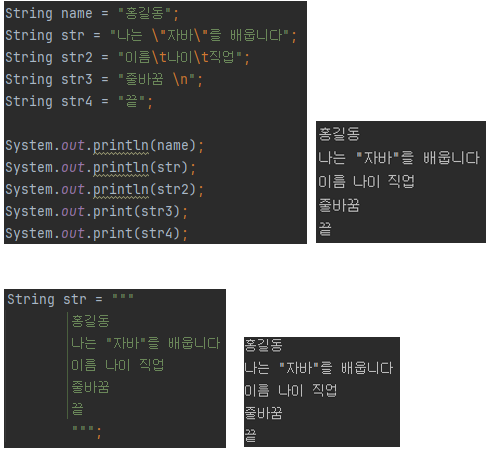

## String (ReferenceType)
```text
✔️ 문자열: String
	⭐ 문자열은 불변
	✅ 암묵적 객체 생성
    ✅ 문자열을 사용 할 때는 ""
	
✔️ 문자열 비교
	-  ==, !=
	⭐ 문자열 리터럴이 같다면 String 객체를 공유

	✅ new 연산자 (객체 생성 연산자) 사용으로 직접 객체를 생성하고 대입 가능
		⚠️ 이 경우 문자열 리터럴이 같더라도 다른 String 객체를 가짐
	
	- equals()
	객체 상관 없이 내부 문자열만 비교할 경우
	
✔️ 문자 추출
	- charAt() 
	메서드를 사용하여 인덱스 값으로 문자를 추출 할 수 있다
	
✔️ 문자열 길이
	- length()
	
✔️ 문자열 대체
	- replace()
	⭐ 기존 문자열 보존(불변) / 새로운 문자열 반환

✔️ 문자열 잘라내기
	- substring()
	index 값을 사용
	(strat, end) 
		○ end 생략시 start부터 끝까지 잘라내기

✔️ 문자열 찾기
	- indexOf()
	해당 문자열의 인덱스(해당 문자열이 시작되는 인덱스)를 반환
	⭐ 해당 문자열이 포함되어 있지 않다면 -1 반환
	
✔️ 문자열 구분
	- split()
	괄호 안에 구분자를 기준으로 문자열을 분리
	⭐ 분리된 문자열은 배열(array)값으로 반환

✔️ escape (이스케이프)
	특정 문자를 포함하고 출력에 영향을 미친다
	
	\"	" 문자 포함
	\'	' 문자 포함
	\\	\ 문자 포함
	\u 16진수	16진수 유니코드로 해당 문자 포함
	\t	출력시 tap만큼 공백
	\n	출력시 줄바꿈
	\r	출력시 캐리지 리턴
	
	
	- 텍스트 블록
	""" ~ """; (java 13부터 지원됨
	
	- 다음 줄 이어서 작성
          문장 끝 \
```
