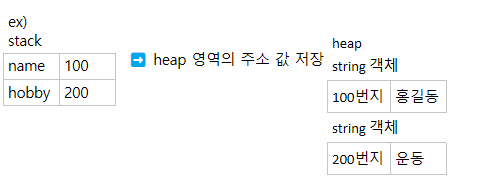

# Reference Type
```text
참조 타입 -> 배열, 열거, 클래스, 인터페이스 

✅ 기본 자료타입 / 참조 타입으로 선언된 변수의 차이점은 저장되는 값이다 

✔️ 참조 타입으로 선언되 변수는 객체가 생성된 메모리 번지를 저장
	✅ 객체란? 데이터와 메소드로 구성된 덩어리 (객체 = 데이터 + 메서드)
	
⭐ java는 기본 자료형을 제외한 모든 자료형은 주소값이 저장
    (기본 자료형만 값을 넘긴다)
```
)	
	
```
name -> 100 / bobby -> 200 주소를 통해 string 객체를 참조

✔️ 참조 타입 변수의 ==, != 연산
	참조 타입 변수에 저장된 값은 heap 영역의 객체의 주소값
	➡️ 주소값을 비교
		⚠️ 저장된 값을 비교 ❌ / 같은 내용을 저장해도 객체가 다르면 false
	
✔️ null

	- null
	참조 타입 변수가 아직 주소값을 저장하고 있지 않다를 의미
	✅ 초기화 값으로 사용 가능 -> null 값으로 초기화된 변수는 스택 영역에 생성
	
		○ ==, != 비교 연산자로 null값 유무 확인 가능

✔️ NullPointerException
	참조 변수 값이 null인 상태에서 객체의 데이터 or 메소드를 사용하려고 할 때 예외(오류)
✅ Java에서 Error = 예외
```